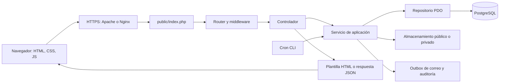
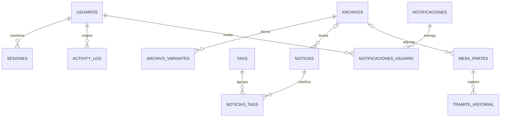
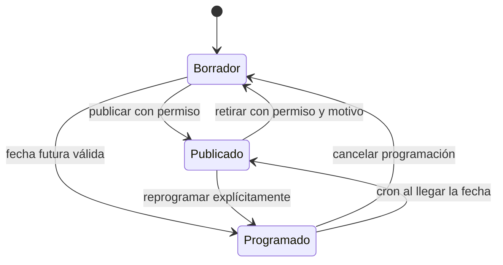

# SDD — Reimplementación del portal y CMS del Colegio Bandera del Perú

**Software Design Description / Documento de Diseño de Software**  
Versión: 1.0 — Propuesta técnica para revisión.  
Fecha: 17 de noviembre de 2026, America/Lima.  
Línea base examinada: `b2db12d1b731551cdc8807ec9c6068a7f8005c6a`, rama seleccionada `main`.  
Tecnología objetivo: PHP nativo, HTML semántico, CSS propio y JavaScript nativo.  
Base de datos propuesta: PostgreSQL.  
Estado: diseño y auditoría documentados; correcciones todavía **no implementadas**.

## Índice

1. [Resumen y decisiones](#1-resumen-y-decisiones)
2. [Alcance y evidencia](#2-alcance-y-evidencia)
3. [Diagnóstico actual](#3-diagnóstico-actual)
4. [Paridad funcional](#4-paridad-funcional)
5. [Personas, permisos y reglas](#5-personas-permisos-y-reglas)
6. [Arquitectura PHP](#6-arquitectura-php)
7. [Navegación y rutas](#7-navegación-y-rutas)
8. [Sistema visual y accesibilidad](#8-sistema-visual-y-accesibilidad)
9. [Diseño del portal público](#9-diseño-del-portal-público)
10. [Diseño del CMS](#10-diseño-del-cms)
11. [Contratos y validación](#11-contratos-y-validación)
12. [Diseño de datos](#12-diseño-de-datos)
13. [Archivos y contenido enriquecido](#13-archivos-y-contenido-enriquecido)
14. [Seguridad y privacidad](#14-seguridad-y-privacidad)
15. [Publicación, concurrencia y correo](#15-publicación-concurrencia-y-correo)
16. [Rendimiento, SEO y observabilidad](#16-rendimiento-seo-y-observabilidad)
17. [Migración y compatibilidad](#17-migración-y-compatibilidad)
18. [Despliegue y operación](#18-despliegue-y-operación)
19. [Pruebas y aceptación](#19-pruebas-y-aceptación)
20. [Plan de ejecución](#20-plan-de-ejecución)
21. [Riesgos y decisiones pendientes](#21-riesgos-y-decisiones-pendientes)
22. [Entregables y definición de terminado](#22-entregables-y-definición-de-terminado)
23. [Trazabilidad y anexos](#23-trazabilidad-y-anexos)

## 1. Resumen y decisiones

Se propone una **nueva implementación de código**, conservando las capacidades válidas del sistema actual y migrando sus datos, archivos y direcciones públicas. El resultado seguirá siendo un CMS completo: cambiar de React/Express a PHP no reduce automáticamente su complejidad.

El portal público adoptará una presentación institucional basada en blanco, rojo y azul marino, con fotografías reales, jerarquía editorial y uso prioritario desde celulares. RCH es la referencia visual elegida por el solicitante. Su distribución exacta no se considera auditada: el acceso externo fue bloqueado en esta sesión. Las imágenes conceptuales generadas en la conversación son orientativas; su escudo, personas, edificio, ubicación y textos no constituyen información oficial.

La reimplementación debe corregir los defectos documentados, no reproducirlos por compatibilidad. Por ejemplo, conservar la gestión de borradores no significa conservar el acceso anónimo mediante `admin=true`.

### 1.1 Decisiones de arquitectura

| ID | Decisión | Motivo y consecuencia |
|---|---|---|
| ADR-01 | PHP nativo con controladores, servicios, repositorios y plantillas | Respeta la tecnología solicitada y evita mezclar permisos, SQL y HTML. Sin Laravel ni framework frontend en la propuesta base. |
| ADR-02 | Renderizado HTML en servidor y mejora progresiva | La lectura pública, búsqueda, formularios y administración esencial funcionan sin depender de una SPA. JavaScript mejora la interacción. |
| ADR-03 | PostgreSQL como único motor inicial | El modelo actual ya es PostgreSQL; evita sumar una segunda migración. PDO no vuelve automáticamente portable el SQL. |
| ADR-04 | Misma aplicación y origen para portal y CMS | Reduce complejidad de CORS, cookies, despliegue y generación de URLs. `/admin` conserva separación de permisos y presentación. |
| ADR-05 | Sesiones almacenadas en servidor | Permite revocar accesos y elimina la necesidad de guardar JWT en `localStorage`. |
| ADR-06 | CSS propio con variables y componentes | Sin Tailwind en producción ni necesidad de compilar el frontend. Se conserva el tema oscuro con tokens propios y pruebas equivalentes. |
| ADR-07 | Dependencias mínimas y justificadas | Sin React, Axios, Recharts, SweetAlert ni sus reemplazos automáticos. Bibliotecas especializadas de sanitización, correo y edición requieren inventario, licencia y versión fijada. |
| ADR-08 | Adjuntos de trámites privados | Se separan de fotografías y documentos institucionales públicos; se descargan mediante autorización. |
| ADR-09 | Cron CLI e infraestructura sencilla | Publicación y correo mediante tareas CLI y cron; no se exige Redis ni un proceso permanente si el hosting no lo permite. |
| ADR-10 | Transición paralela y corte controlado | La aplicación actual permanece disponible hasta validar la nueva. Se utilizan checkouts existentes; no se requiere crear un worktree. |

**MySQL es una alternativa de alojamiento**, no una decisión tomada. Si el colegio elige un hosting que no admite PostgreSQL, se debe aprobar un ADR adicional, convertir SQL e índices, ensayar la migración y repetir las pruebas. Este SDD no promete soporte simultáneo de ambos motores.

## 2. Alcance y evidencia

### 2.1 Qué se examinó

- Manifiestos y archivos de bloqueo de raíz, frontend y backend; scripts de arranque y CI.
- Enrutamiento público y administrativo, autenticación, controladores, validadores, almacenamiento y seis migraciones SQL.
- Componentes compartidos, formularios y páginas relevantes del portal y del CMS.
- Ejecución local en Chromium de 11 rutas a 1440×1000 y 390×844: 22 observaciones. Capturas de portada, noticias, comunicados, mesa de partes, dashboard y administración de noticias.
- Peticiones HTTP sobre una **base exclusiva de auditoría** con registros ficticios: visibilidad de publicaciones, diagnóstico, paginación, sitemap, reordenamiento y revocación de permisos.
- Pruebas existentes, lint, compilación y auditoría npm completa y de dependencias de producción.

La aplicación bajo auditoría utilizó `colegio_audit_20261117`, separada de la base de desarrollo preexistente. Los identificadores `AUDIT_*` y el usuario `auditoria` son datos sintéticos. No se consultó una base de producción ni se introdujeron contenidos reales del colegio.

### 2.2 Límites de las conclusiones

Este documento no constituye una certificación de ausencia de vulnerabilidades ni una auditoría exhaustiva de infraestructura. No se verificaron producción, DNS, correo real, permisos efectivos de un bucket remoto, copias de respaldo, tráfico real, navegadores físicos, uso con lectores de pantalla ni la apariencia actual de RCH. Las pantallas no recorridas se analizan por código y se identifican como tales.

Las observaciones distinguen:

| Marca | Significado |
|---|---|
| E | Comportamiento reproducido en ejecución local aislada. |
| C | Evidencia directa del código; no se afirma reproducción en producción. |
| R | Riesgo de diseño o cobertura pendiente; explotación o impacto real no demostrado. |
| D | Decisión de mejora propuesta, no necesariamente un defecto del sistema. |

Severidades del proyecto: **P0** pérdida de autorización o exposición sensible reproducida; **P1** bloqueo funcional, seguridad alta o pérdida de integridad; **P2** problema de usabilidad, consistencia o mantenibilidad; **P3** mejora menor. No son puntuaciones CVSS.

### 2.3 Documentación complementaria obligatoria

- [Auditoría detallada y correcciones](AUDITORIA-ACTUAL.md): hallazgos identificados `H-xx`, fuentes, impacto, requisito correctivo y prueba.
- [Matriz de trazabilidad](TRAZABILIDAD-SDD.csv): `hallazgo → requisito → aceptación → fase`.
- [Inventario de endpoints actuales](INVENTARIO-ENDPOINTS-ACTUALES.md): rutas detectadas en el código de la línea base.
- [Evidencia de ejecución](evidencia-sdd/README.md): resultados, capturas y límites de reproducción.

## 3. Diagnóstico actual

### 3.1 Estado de las comprobaciones

| Comprobación | Resultado observado | Interpretación |
|---|---|---|
| `npm test` | 29 pruebas backend + 14 frontend aprobadas | Verifican principalmente sanitización, validadores y middleware; no demuestran paridad del CMS ni seguridad completa. |
| `npm run lint` | Falló: 40 errores y 17 advertencias | Incumple el propio control de calidad del repositorio. No todos son errores visibles para el usuario. |
| `npm run build` | Compiló; advertencia de fragmento administrativo de aproximadamente 1,1 MB minificado | Tamaño de archivo de compilación, no medición de descarga real ni Core Web Vitals. |
| Auditoría npm, frontend completo | 37 entradas: 3 críticas, 24 altas, 9 moderadas y 1 baja | Incluye herramientas de desarrollo; conteo de paquetes reportados, no incidentes independientes. |
| Auditoría npm, backend completo | 14 entradas: 2 críticas, 7 altas y 5 moderadas | Incluye dependencias transitivas y de pruebas. |
| Auditoría npm, frontend `--omit=dev` | 11 entradas: 1 crítica, 9 altas y 1 moderada | El aviso crítico aparece asociado a DOMPurify; aplicabilidad depende de la configuración utilizada. |
| Auditoría npm, backend `--omit=dev` | 12 entradas: 2 críticas, 7 altas y 3 moderadas | Express hereda avisos transitivos; no sumar estos conteos a los completos. |
| Navegación local | Sin excepciones JS no controladas en las 22 observaciones | Hay errores capturados y comportamientos incorrectos aunque la consola no lance una excepción. |

Los avisos npm corresponden a las respuestas del registro del 17/11/2026. Se conservan los JSON originales. No se ejecutó `npm audit fix`, no se alteraron lockfiles y no se probó la explotación de cada aviso. La ausencia de React en el futuro no sustituye la revisión de seguridad de PHP y de las bibliotecas que se seleccionen.

### 3.2 Problemas determinantes

1. **Autorización:** un visitante obtiene borradores cambiando un parámetro; búsqueda y estadísticas también muestran información no publicada. Los JWT sobreviven a eliminación de usuario y cambios de rol.
2. **Contratos:** la portada interpreta una respuesta paginada como un array; comunicados espera campos distintos a los enviados por el backend.
3. **Lectura pública:** el botón de expansión de noticias es inerte y no existen páginas individuales de noticias en el router.
4. **Operación del CMS:** la navegación lateral solo pertenece al dashboard y desaparece al entrar a módulos. En móvil ocupa gran parte de la anchura y el contenido se recorta.
5. **Mesa de partes:** el código devuelto por la API no se muestra al remitente; no hay seguimiento visible en esa página y la bandeja no permite leer todo el expediente.
6. **Modelo:** existen dos tablas de relación para etiquetas de noticias, rutas de reordenamiento incompatibles y formatos de archivo/URL inconsistentes.
7. **Publicación y contenido:** configuración que no llega a la portada, páginas institucionales y directivos codificados, módulos existentes en API sin interfaz completa.
8. **Entrega:** lint fallido, pruebas de integración insuficientes y configuración de desarrollo que requiere arreglos externos para arrancar.

El detalle y los matices están en el anexo; ninguna corrección se considera realizada por aparecer aquí.

## 4. Paridad funcional

Se conserva el **resultado de negocio**, no la implementación defectuosa. Estados usados en esta tabla: activo, parcial, API sin interfaz y contenido fijo.

| ID funcional | Capacidad actual | Situación de la línea base | Diseño objetivo y aceptación principal |
|---|---|---|---|
| RF-01 | Inicio y novedades | Activo con integración defectuosa | Inicio editable y publicaciones realmente visibles; fallo de fuente no se presenta como inexistencia de contenido. |
| RF-02 | Páginas institucionales, historia, misión, valores, propuesta, talleres y TIC | Texto fijo en JSX | Páginas versionadas y editables, conservando rutas y material validado. |
| RF-03 | Noticias | CRUD y estados; lectura incompleta | CRUD, HTML permitido, portada, etiquetas, búsqueda global, detalle único, programación y vista previa privada. |
| RF-04 | Comunicados | CRUD; campos públicos incompatibles | Tipos existentes, lectura completa, filtros y estados coherentes entre formulario, BD y salida. |
| RF-05 | Eventos | CRUD, imagen, fecha, hora, lugar y estados | Vista lista y calendario, detalle accesible y fechas correctas en Lima. |
| RF-06 | Galería | Foto/video, fecha y orden; sin edición completa | Alta, edición, baja lógica, orden, filtros, textos alternativos y reproducción controlada. |
| RF-07 | Documentos institucionales | Alta/baja y categorías | Alta, sustitución/versiones, descarga pública, tamaño y fecha; búsqueda y categorías normalizadas. |
| RF-08 | Docentes | CRUD y orden | Publicación de datos profesionales, fotos y orden persistente. |
| RF-09 | Administrativos | CRUD; orden defectuoso | Mismas operaciones con orden verificable; no se muestran datos privados. |
| RF-10 | Equipo directivo | API CRUD; página usa datos fijos | Gestión real desde CMS y reflejo en página pública. |
| RF-11 | Carrusel | API alta/baja/orden; inicio no lo consume | Gestión completa de diapositivas o una portada fija seleccionada; la capacidad queda disponible. |
| RF-12 | Personalización | Hero, métricas y pilares; aplicación parcial | Campos tipados, carga de imágenes, bloques conectados y previsualización real. |
| RF-13 | Mesa de partes | Registro, consulta API, lista y estados | Registro idempotente, constancia, seguimiento, ficha privada, historial y adjuntos privados. |
| RF-14 | Admisiones | API de solicitudes; ruta pública redirige | Módulo separado de mesa de partes; recuperar funciones y datos existentes sin confundir finalidades. |
| RF-15 | Usuarios y roles | Admin/editor/user; JWT | Gestión por capacidades, último administrador protegido, sesiones revocables y perfil propio. |
| RF-16 | Cambio/recuperación de contraseña | Cambio autenticado y reseteo administrativo; endpoint temporal | Cambio, reseteo seguro y recuperación con token de un uso. Las columnas existentes no demuestran un flujo de recuperación por correo ya terminado. |
| RF-17 | Etiquetas | CRUD, búsqueda y relaciones | Una relación canónica por recurso, slug único, conteos de contenido público y selección accesible. |
| RF-18 | Dashboard y estadísticas | Contadores, gráficos y pendientes | Datos con definiciones verificables; acceso por permiso y tablas equivalentes a gráficos. |
| RF-19 | Actividad y exportación | Registro parcial y CSV | Auditoría consistente y CSV seguro; filtros y exportación completa controlada. |
| RF-20 | Notificaciones | Bandeja y lectura global compartida | Notificación por destinatario, estados individuales y contenido acorde al permiso. |
| RF-21 | Visitas | Contadores por página/día | Conteo agregado documentado; exclusión de administración y datos personales. |
| RF-22 | Tema claro/oscuro | Disponible | Preservar preferencia con contraste comprobado; no utilizar reemplazos globales indiscriminados. |
| RF-23 | Ayuda, bienvenida y recorridos | Componentes presentes | Ayuda por tarea y recorridos opcionales; cierre persistente por usuario/versión. |
| RF-24 | SEO, búsqueda, compatibilidad | Metadatos globales y sitemap defectuoso | HTML indexable, detalles, canonical por página, sitemap correcto y redirecciones verificadas. |

**Regla de alcance:** ninguna fila se elimina por conveniencia técnica. Una capacidad redundante puede simplificarse solo mediante decisión documentada del colegio, con tratamiento de sus datos y enlaces. Nuevas mejoras de flujo se distinguen de funciones ya existentes.

## 5. Personas, permisos y reglas

### 5.1 Personas y tareas prioritarias

| Persona | Necesidad | Éxito observable |
|---|---|---|
| Familiar desde móvil | Encontrar un aviso, requisitos o un trámite | Llega al contenido correcto sin abrir un panel de personal ni recorrer menús ambiguos. |
| Estudiante | Consultar calendario, actividades y recursos | Fecha/lugar claros, archivos identificados y navegación con teclado. |
| Ciudadano remitente | Registrar y consultar expediente | Recibe constancia y código; puede recuperar el estado sin exponer su DNI en una URL. |
| Editor | Preparar y actualizar contenido | Conserva trabajo, distingue borrador/programado/publicado y reconoce qué ya está visible. |
| Administrador | Publicar, atender trámites y gestionar accesos | Opera en un panel consistente; las acciones quedan auditadas y puede revocar una sesión. |
| Responsable técnico | Desplegar y restaurar | Procedimientos repetibles, copias verificadas y diagnóstico sin revelar secretos públicamente. |

### 5.2 Matriz de permisos propuesta

La autorización se evalúa **en el servidor en cada petición**, también en peticiones `fetch`, descargas, previews y exportaciones. El menú solo refleja esos permisos.

| Capacidad | Visitante | `user` heredado | Editor | Administrador |
|---|---|---|---|---|
| Ver contenido público vigente | Sí | Sí | Sí | Sí |
| Enviar solicitud y consultar su constancia | Sí, con controles | Igual | Igual | Igual |
| Perfil y contraseña propios | — | Sí | Sí | Sí |
| Crear/editar noticias, comunicados, eventos, docentes, galería y carrusel | — | — | Sí | Sí |
| Publicar/programar esos contenidos | — | — | Sí, para conservar capacidad vigente | Sí |
| Eliminar contenido | — | — | — | Sí, con confirmación y papelera |
| Crear/seleccionar etiquetas | — | — | Sí | Sí |
| Eliminar etiquetas | — | — | — | Sí |
| Administrativos, directivos, documentos y configuración institucional | — | — | — | Sí |
| Trámites, adjuntos privados y admisiones | — | — | — | Sí |
| Usuarios, roles y auditoría global | — | — | — | Sí |
| Métricas internas | — | — | Agregados editoriales permitidos | Sí |
| Notificaciones | — | — | Solo destinatario y asunto permitido | Solo destinatario o bandeja autorizada |

La línea base permite crear etiquetas por API al editor pero oculta su página mediante `SoloAdminRoute`: el destino debe ser coherente. Un flujo adicional de aprobación editorial se puede incorporar después de una decisión del colegio; no se inventa como condición para preservar la funcionalidad actual.

`user` heredado no recibirá privilegios de editor por migración. Se inventariarán sus cuentas y se asignará explícitamente su acceso. Roles de secretaría y publicador pueden añadirse con capacidades sin reescribir todo el sistema, pero no se presupone su aprobación.

### 5.3 Invariantes del dominio

- Una sesión válida requiere usuario existente, activo y con versión de acceso vigente.
- Ninguna acción puede dejar al sistema sin administrador activo; se controla dentro de una transacción con bloqueo.
- Un contenido es público si `estado = publicado`, su fecha de publicación ha llegado y no está eliminado. La misma regla se aplica a listados, detalles, etiquetas, buscador, portada, sitemap y caché.
- Guardar como borrador nunca cambia por defecto a publicado. Un formulario nuevo comienza en borrador.
- Estado `programado` exige fecha futura válida; el servidor interpreta Lima y almacena el instante en UTC.
- Un recurso inexistente no produce confirmación de guardado o eliminación exitosa.
- Los adjuntos privados nunca se vuelven públicos por cambiar de proveedor de almacenamiento.
- Registro de trámite y emisión de su código se completan juntos. El fallo del correo no deshace un expediente correctamente recibido.
- Ningún contenido institucional se completa con cifras, nombres o contactos inventados.

## 6. Arquitectura PHP

### 6.1 Flujo de petición



La petición pasa por identificación de solicitud, configuración, limitación de uso, sesión, autenticación, permiso, CSRF y validación antes de ejecutar una operación. Las rutas públicas siguen una cadena explícita adecuada a su finalidad; no dependen del orden accidental de registro.

### 6.2 Estructura propuesta

```text
colegio-php/
├── public/
│   ├── index.php
│   └── assets/{css,js,icons,images}/
├── app/
│   ├── Http/{Controllers,Middleware,Requests,Responses}/
│   ├── Application/{Content,Identity,Records,Media,Analytics}/
│   ├── Domain/{Entities,Policies,Exceptions}/
│   ├── Infrastructure/{Database,Storage,Mail,Logging,Clock}/
│   └── Views/{layouts,partials,public,admin,errors,emails}/
├── config/
├── routes/{web.php,admin.php,json.php}
├── database/{migrations,seeds}/
├── bin/console
├── storage/{private,cache,logs,sessions,temp}/
├── tests/{Unit,Integration,Security,Browser,Fixtures}/
├── composer.json
├── composer.lock
└── .env.example
```

Solo `public/` se expone como raíz del servidor. Configuración, código, `vendor/`, copias, sesiones y almacenamiento privado quedan fuera. Los archivos publicados se entregan mediante un directorio explícito de medios o un servicio de objetos; jamás se habilita ejecución PHP allí.

### 6.3 Responsabilidades

- **Router:** rutas estáticas antes de parámetros; tipos de identificador, método y middleware declarados.
- **Controlador:** recibe una petición validada, llama al caso de uso y selecciona respuesta. No concatena SQL ni decide permisos según parámetros del cliente.
- **Servicio:** reglas de publicación, transacción, concurrencia, auditoría y coordinación de almacenamiento.
- **Repositorio:** PDO, parámetros preparados, proyecciones de campos y paginación. Excepciones técnicas no salen al visitante.
- **Plantilla:** HTML escapado por defecto; solo un tipo de contenido previamente sanitizado puede renderizarse como HTML.
- **Política:** capacidades por acción y visibilidad por recurso. La vista previa usa la misma política que el CMS.
- **Adaptador:** correo, almacenamiento, reloj y logger intercambiables y testeables.

### 6.4 Requisitos de implementación

PHP 8.4 o una rama posterior con soporte de seguridad vigente al desplegar, fijando versión menor y parche compatibles. PostgreSQL 16 o posterior soportado; extensiones `pdo_pgsql`, `mbstring`, `fileinfo`, `openssl`, `intl` y GD/Imagick según el procesado seleccionado. OPcache en producción. Composer puede usarse para autoload y dependencias justificadas; sus archivos de bloqueo forman parte del repositorio futuro.

Sin npm obligatorio para construir o ejecutar la aplicación final. Las herramientas de pruebas pueden utilizar Node en CI sin introducir React ni un servidor Node en producción. Los módulos JavaScript se sirven como archivos estáticos locales y versionados.

### 6.5 Tratamiento de errores

Una excepción se registra con identificador de correlación, código interno y contexto mínimo. El visitante recibe un mensaje útil y una vía de recuperación, nunca SQL, trazas, claves, rutas privadas o el cuerpo completo de su trámite. En formularios, errores de validación conservan valores y sitúan el foco en un resumen enlazado a cada campo.

Las escrituras HTML usan Post/Redirect/Get con redirección `303`; las mejoras `fetch` siguen contratos equivalentes. Se presentan estados distintos para vacío, sin coincidencias, fallo de carga, falta de permiso, sesión expirada y servicio no disponible.

## 7. Navegación y rutas

### 7.1 Arquitectura de información pública

Menú principal propuesto: **Inicio · Nuestro colegio · Propuesta educativa · Actualidad · Servicios · Contacto**. Documentos y mesa de partes se encuentran en Servicios y también en accesos rápidos. Aula de innovación pertenece a Propuesta educativa. El acceso del personal se denomina **Acceso del personal**, evitando sugerir que existe una intranet académica para estudiantes.

Los menús se activan por botón con clic, toque, Enter y Espacio. Exponen `aria-expanded` y `aria-controls`, cierran con Escape y conservan foco. Un enlace real representa el escudo; las rutas activas utilizan `aria-current`. No se obliga a usar hover para encontrar contenido.

### 7.2 Contrato de rutas objetivo

| Familia | Rutas representativas | Regla |
|---|---|---|
| Institucional | `/nuestro-colegio`, `/historia`, `/mision`, `/valores`, `/organigrama` | HTML con contenido publicado; organigrama con alternativa textual. |
| Académico | `/propuesta`, `/talleres`, `/docentes`, `/tic/aula`, `/tic/recursos`, `/tic/proyectos` | Sin enlaces a secciones inexistentes. |
| Noticias | `/noticias`, `/noticias/{id}/{slug}` | Listado y detalle; slug antiguo redirige al canonical actual. |
| Comunicados | `/comunicados`, `/comunicados/{id}/{slug}` | Lectura completa y categoría correcta. |
| Eventos | `/eventos`, `/eventos/{id}/{slug}` | Vista lista por defecto y calendario accesible alternativo. |
| Personal | `/directivo`, `/administrativos` | Datos publicados desde CMS. |
| Galería/etiquetas | `/galeria`, `/tags`, `/tags/{slug}` | Filtrado de visibilidad centralizado. |
| Documentos | `/documentos-institucionales`, `/documentos/{id}/descargar` | Metadatos públicos y descarga controlada por clasificación. |
| Matrícula | `/matricula`, `/admision` | Información de matrícula y formulario de consulta con finalidad propia. |
| Trámites | `/mesa-partes`, `/mesa-partes/constancia`, `/mesa-partes/seguimiento` | Formularios POST; constancia privada y sin DNI en query string. |
| Contacto/legal | `/contacto`, `/privacidad`, `/accesibilidad` | Datos oficiales, tratamiento y canal de ayuda. |
| Acceso | `/login`, `/logout`, `/recuperar-acceso`, `/restablecer-acceso` | Logout POST y CSRF; recuperación de un uso. |
| CMS | `/admin`, `/admin/{modulo}`, `/admin/{modulo}/nuevo`, `/admin/{modulo}/{id}/editar` | Layout persistente, autenticación y capacidad. |
| Salud/SEO | `/health/live`, `/health/ready`, `/robots.txt`, `/sitemap.xml` | Salud pública mínima; readiness responde 503 si falla dependencia necesaria. |

Los identificadores de noticias públicas no autorizan acceso a borradores. Los identificadores internos de archivos privados nunca bastan para descargarlos.

`/transparencia` conserva redirección permanente a documentos. `/nosotros` puede mantenerse como alias a Nuestro colegio. La antigua redirección `/admision → /mesa-partes` se sustituye por una página con finalidad correcta, preservando la URL de admisiones. No existe una redirección universal de errores hacia Inicio: una ruta desconocida devuelve 404 real y ayuda contextual.

### 7.3 Rutas de escritura

HTML utiliza POST para crear, editar, cambiar estados, reordenar, cerrar sesión y enviar solicitudes; cada ruta declara su acción. JSON puede emplear POST/PATCH/DELETE y debe devolver `405` con `Allow` ante métodos incorrectos. Ningún GET cambia estado, publica, elimina ni resetea contraseñas.

Las rutas de emergencia y diagnóstico de la versión anterior no se publican en la nueva aplicación. El mantenimiento se realiza por CLI con acceso al servidor y queda auditado.

## 8. Sistema visual y accesibilidad

### 8.1 Identidad y dirección visual

Blanco predominante para lectura y separación; azul marino para estructura, títulos y pie; rojo para acción principal y acentos. Fotografía institucional con composición editorial y textos breves. La referencia RCH se traduce en una dirección a validar mediante capturas o acceso posterior; no se afirma que esta propuesta copie componentes concretos de una página no inspeccionada.

| Token propuesto | Valor inicial | Uso |
|---|---|---|
| `--brand-navy` | `#102A43` | Navegación, títulos, pie y botones secundarios. |
| `--brand-red` | `#C62828` | CTA principal y detalles institucionales. |
| `--surface` | `#FFFFFF` | Fondo principal y tarjetas. |
| `--surface-subtle` | `#F5F7FA` | Alternancia de secciones y fondos de formularios. |
| `--text` | `#172B4D` | Texto principal. |
| `--text-muted` | `#475569` | Metadatos legibles. |
| `--border` | `#CBD5E1` | Límites y estados de controles. |

Estos valores son propuestas; el escudo y el manual oficial determinan los definitivos. Los colores de estado se acompañan de etiqueta e icono y no sustituyen la identidad visual. Se eliminan gradientes multicolor decorativos innecesarios y la proliferación de estilos independientes por módulo.

No se oscurece todo el sitio para lograr identidad: la fotografía y los espacios blancos proporcionan balance. Una única acción primaria por grupo y jerarquía clara entre publicar, guardar borrador y cancelar.

### 8.2 Tipografía, espacio y adaptación

- Familia de texto local o del sistema; no depender de Google Fonts para mostrar contenido. Cuerpo base de 16 px y altura de línea 1,5–1,7. Texto auxiliar normalmente de 14 px; evitar 8–10 px en categorías, acciones o instrucciones esenciales.
- Contenedor de lectura de aproximadamente 65–75 caracteres por línea; contenido general máximo entre 1180 y 1280 px con márgenes fluidos.
- Escala de espacio de 4, 8, 12, 16, 24, 32, 48 y 64 px. Componentes alineados con esa escala y sin grandes huecos causados por secciones vacías.
- Objetivo de interacción de al menos 44×44 px para acciones frecuentes y separación suficiente; al menos 24×24 px donde aplica WCAG 2.2, justificando sus excepciones.
- Pruebas a 320, 360, 390, 768, 1024, 1280 y 1440 px. No basta comprobar `scrollWidth`: también se inspecciona recorte dentro de contenedores, como ocurre en el dashboard actual.
- A 200 % de zoom, controles, texto y confirmaciones continúan utilizables. A 400 %/ancho equivalente a 320 px se verifica reflujo, admitiendo desplazamiento local solo en contenidos esencialmente bidimensionales.
- Barra lateral administrativa colapsable antes de que comprometa el área de trabajo; en móvil se transforma en panel superpuesto cerrado inicialmente. El contenido ocupa todo el ancho disponible.
- Imágenes del hero visibles también en móvil, con recorte y punto focal configurables. No se entrega una foto pesada para después ocultarla con CSS.

### 8.3 Componentes normalizados

| Componente | Contrato obligatorio |
|---|---|
| Botón | Variante primaria/secundaria/peligro; estado ocupado; texto claro; nombre accesible; evitar doble envío. |
| Enlace | Destino real y texto que describa el contenido. Descargas indican tipo y tamaño; acciones mutantes usan botones. |
| Campo | Label persistente, `id` único, ayuda, requerido/opcional, límites, valor conservado y error vinculado. |
| Mensaje | Diferenciar confirmación, advertencia y error; avisos importantes persistentes; región viva apropiada sin repetir anuncios. |
| Tarjeta editorial | Imagen con proporción estable, categoría real, título enlazado, fecha, extracto y acceso a detalle. |
| Lista/tabla | Encabezados y caption; orden explícito; filtros por servidor; selección y acciones con contexto. |
| Paginación | Página actual, total, anterior/siguiente y filtros persistentes; actualización que anuncia resultado y sitúa foco correctamente. |
| Modal | Nombre y descripción; foco inicial, contención de Tab, Escape, fondo inerte y devolución al disparador. Confirmación destructiva fuera de modales anidados. |
| Estado vacío | Mensaje específico y acción adecuada; no equivale a error de servicio. |
| Vista previa | Mismas plantillas públicas, permiso privado y distintivo “Vista previa — no publicado”. |
| Reordenamiento | Arrastre opcional más botones Subir/Bajar y alternativa con teclado; guardar y cancelar claramente diferenciados. |
| Notificación | Fecha, estado de lectura individual, asunto autorizado y destino existente. |

### 8.4 Accesibilidad exigida

Objetivo WCAG 2.2 AA para las plantillas y flujos entregados. Incluye contraste de texto normal 4,5:1, texto grande 3:1 y contraste de controles/información gráfica 3:1 donde corresponde. Los valores se verifican sobre estados reales, overlays, hover, foco y ambos temas.

Todas las páginas tienen `lang="es"`, título propio, un `main` identificable, jerarquía de encabezados y enlace para saltar al contenido. El foco permanece visible y no queda tapado por cabeceras. La navegación con teclado no depende del ratón. Las preferencias `prefers-reduced-motion` limitan movimiento sin ocultar información.

Las fotografías informativas llevan texto alternativo editorial; las decorativas usan `alt=""`. Los gráficos tienen resumen y tabla de datos. Los videos tienen controles y, si contienen información hablada institucional, subtítulos y alternativa textual. El PDF no sustituye toda la información necesaria para completar un trámite.

El tema oscuro conserva contraste y jerarquía mediante tokens específicos; la preferencia puede almacenarse sin datos de autenticación. La auditoría actual no certificó todos sus estados: su corrección se valida en la nueva implementación.

## 9. Diseño del portal público

### 9.1 Inicio

Orden propuesto:

```text
Franja breve de contacto/aviso vigente, si existe
Cabecera: escudo oficial + nombre + navegación + acceso del personal
Hero fotográfico: mensaje breve + CTA institucional + CTA de servicio
Accesos rápidos: matrícula, comunicados, calendario, mesa de partes
Presentación del colegio + fotografía
Propuesta educativa / vida escolar
Noticias y comunicados recientes
Próximos eventos
Galería seleccionada
Contacto y pie institucional
```

El hero admite una fotografía principal o diapositivas administradas. El movimiento automático estará desactivado por defecto; si se habilita, debe haber pausa accesible y no causar cambios de foco. No se utiliza un video automático pesado.

La primera pantalla comunica nombre, ubicación validada y propósito. Una frase principal de extensión limitada evita partir una palabra o ocupar varias pantallas en móvil. Las cifras institucionales requieren valor, etiqueta, fecha y responsable de validación; una cifra sin fuente se oculta, no se rellena con `1200+` o `98 %` por defecto.

La portada consume proyecciones públicas del servidor, no un contrato distinto para cada bloque. Un error de novedades mantiene el resto del inicio y permite reintentar; no afirma “Sin publicaciones” si la consulta falló. El orden editorial puede configurarse dentro de opciones controladas, sin crear un constructor libre de HTML.

### 9.2 Noticias y comunicados

Listado con título, filtros, total de resultados y paginación del servidor. La búsqueda abarca todos los registros permitidos, no solo la página descargada. Los parámetros `q`, categoría, etiqueta, página y orden aparecen en la URL y sobreviven a volver desde un detalle.

Cada noticia tiene página propia con título, fecha de publicación, fotografía, pie/crédito cuando corresponda, contenido completo sanitizado y noticias relacionadas públicas. Compartir utiliza una URL canónica estable. “Leer noticia” es un enlace real, nunca un botón sin destino.

Los comunicados usan un campo canónico `tipo` y un cuerpo coherente. Valores heredados: urgente, académico, administrativo, general y aviso; las etiquetas visibles pueden llevar tildes. Se retira “Social” del filtro si no existe en el catálogo aprobado o se migra explícitamente. Urgencia combina texto e icono, sin depender del rojo.

El contenido completo no queda limitado por `max-height`. La copia de un enlace lleva directamente al contenido, aun con JavaScript desactivado.

### 9.3 Eventos

Lista ordenada de próximos eventos y acceso a anteriores. Cada evento muestra fecha, hora, lugar y descripción; si no tiene hora, se informa “Horario por confirmar”. El calendario es mejora opcional sobre la lista y permite operar con teclado. La zona horaria se expresa cuando sea relevante y nunca desplaza una fecha escolar por convertir una fecha sin hora a UTC.

### 9.4 Galería

Filtros por año y tipo; paginación; miniaturas optimizadas. Una foto abre una vista ampliada accesible y tiene un destino alternativo. Video limitado a proveedores aprobados mediante identificador; no se almacena HTML arbitrario de iframe. Se utiliza carga diferida y consentimiento/aviso apropiado antes de contenido de terceros cuando corresponda.

Se conservan orden y fecha. El administrador puede corregir un título, texto alternativo o enlace sin eliminar y volver a cargar el elemento.

### 9.5 Institución y personal

Historia, misión/visión, valores, propuesta, talleres y TIC se gestionan como páginas con bloques permitidos. Los contenidos heredados codificados en JSX se importan como borradores hasta validación institucional. No se presupone que los nombres de directivos, talleres, lemas o reconocimientos actuales sean correctos.

Las fichas profesionales muestran únicamente datos aprobados para publicación. El organigrama incluye archivo válido y jerarquía textual; no se publica un recuadro vacío si falta el archivo. Los cambios realizados en CMS deben ser visibles sin desplegar código.

### 9.6 Documentos

Catálogo por categoría y año, búsqueda de título y descripción, fecha de actualización, versión, tipo y tamaño. Descarga claramente identificada, con alternativa de abrir y aviso si abre otra ventana. Se conserva la relación entre versiones y no se rompe una URL pública ya difundida por sustituir el archivo.

### 9.7 Mesa de partes

Flujo completo:

1. Página de orientación con finalidad, horario oficial, requisitos, formatos, límites y aviso de privacidad.
2. Formulario con asunto, nombre, documento de identidad, dirección cuando esté justificada, teléfono, correo opcional y fundamentación. Se conserva inicialmente la compatibilidad con DNI de ocho dígitos; otros documentos requieren decisión de negocio y campos diferenciados.
3. Adjuntar PDF o imagen según política; ver nombre, tamaño, estado y opción de retirar. No se anuncian DOC/DOCX si el servidor no los admite.
4. Revisión y confirmación de datos; validación del servidor aunque JavaScript falle.
5. Registro idempotente y generación de código aleatorio con entropía suficiente. Se muestra una constancia imprimible con código, fecha/hora, asunto, estado inicial y enlace de consulta.
6. Mensaje independiente sobre correo: enviado, pendiente o no proporcionado. La falta de entrega no convierte un expediente recibido en fallido.
7. Consulta mediante POST de código y documento; límite de intentos, respuesta genérica al fallar y salida mínima al acertar. DNI fuera de URL, historial, analítica y logs.

El ciudadano puede copiar o imprimir su constancia. Refrescar o repetir por un corte de red con la misma clave idempotente devuelve el mismo resultado; no crea otro trámite. Datos del formulario pueden conservarse en sesión durante el proceso, nunca automáticamente en `localStorage` con DNI y fundamentación.

El código propuesto emplea prefijo legible de año más una parte generada con `random_bytes`, equivalente al menos a 128 bits. El código heredado se conserva para expedientes antiguos; no se convierte un código corto en autorización suficiente para descargar adjuntos.

### 9.8 Matrícula y admisiones

Separar información de matrícula, consulta de interés y trámite administrativo. La consulta de admisión conserva nombre del responsable, estudiante, grado y celular, con finalidad y permisos propios. La bandeja administrativa existe aunque la interfaz anterior la redirigiera. No se promete una matrícula oficial automática ni un sistema académico que no forma parte de la línea base.

### 9.9 Contacto y búsqueda global

Contacto con dirección, horarios, teléfono enlazado y correo oficiales; mapa con alternativa textual. Redes sociales solo si su URL institucional está validada. Se eliminan enlaces genéricos a las portadas de Facebook y YouTube.

Buscador global con formulario GET, resultados por tipo y enlace directo al detalle. Aplica política pública antes de contar o devolver resultados. No busca DNI, nombres de remitentes, correos, usuarios o expedientes privados. Con JavaScript disponible puede sugerir resultados; la búsqueda completa continúa operativa con Enter.

## 10. Diseño del CMS

### 10.1 Estructura persistente

Todas las pantallas utilizan el mismo layout: cabecera, navegación por capacidades, título de página, breadcrumb, contenido y acceso a ayuda/cuenta. El módulo activo permanece identificado. En móvil hay botón de menú, navegación superpuesta y área principal completa; cerrar menú devuelve el foco al botón.

El dashboard no es propietario de la barra lateral de los demás módulos. Entrar por URL directa a una edición conserva la estructura y autorización. El botón Atrás, los filtros y la posición de una lista no provocan pérdida inesperada de trabajo.

### 10.2 Listados administrativos

Cabecera con tarea y acción principal. Filtros por estado y búsqueda del servidor; columnas esenciales primero. Valores iniciales: 20 elementos/página, opciones 20/50 y máximo de 100 para CMS; máximos públicos menores donde proceda. Conteos y página consistentes después de eliminar el último elemento de una página.

En móvil las tablas editoriales se convierten en tarjetas con acciones visibles. Una tabla que deba conservar columnas tiene desplazamiento local etiquetado; no recorta toda la pantalla. Acciones de icono indican nombre y recurso, por ejemplo “Editar noticia: …”. Eliminar se separa de Editar, informa consecuencias y utiliza confirmación explícita.

### 10.3 Crear y editar contenido

Formulario organizado en contenido, medios y publicación. Un asistente puede conservarse como ayuda, pero cada paso valida sus campos antes de avanzar y permite regresar sin perderlos. La presentación inicial no oculta campos que necesitan corregirse.

Acciones: **Guardar borrador**, **Vista previa** y **Publicar/Programar** según selección. Estado y visibilidad real se explican: un registro con fecha futura no se etiqueta engañosamente como visible ahora. La validación distingue fecha de evento, fecha editorial y fecha de publicación.

Se implementa guardado de borrador explícito y, como mejora controlada, autoguardado al servidor con indicador de estado y control de versión. No se confirma “Guardado” antes de recibir respuesta exitosa. Un aviso de salida detecta cambios pendientes; archivos y campos mantienen contexto ante errores. La vista previa abre la plantilla definitiva y no modifica el estado.

El editor enriquecido conserva las funciones actuales relevantes: párrafo, negrita, cursiva, tachado, títulos H2/H3, listas, cita, separador, deshacer/rehacer y limpiar formato. La selección de una biblioteca standalone queda documentada en ADR; ni un `textarea` plano ni una implementación improvisada se declaran equivalentes sin validación.

### 10.4 Reordenamiento

Lista completa del conjunto reordenable, sin confundir un filtro o una página con todo el orden. Arrastrar es una comodidad; Subir/Bajar y teclado proporcionan alternativa. La petición usa un contrato único de IDs, rechaza duplicados/inexistentes y guarda todas las posiciones en una transacción.

Después de guardar se vuelve a consultar y se verifica la lectura pública. Guardado parcial, ID fuera del conjunto o edición concurrente devuelven conflicto con opción de recargar, sin reemplazar silenciosamente el trabajo de otra persona.

### 10.5 Atención de trámites

Bandeja paginada con código, asunto, remitente parcialmente enmascarado, fecha, estado y responsable si se habilita asignación. Cada expediente abre una ficha completa con datos de contacto, fundamentación, adjuntos privados, historial y acciones autorizadas. El personal no necesita consultar directamente la base de datos para leer una solicitud.

Estados compatibles: pendiente → en proceso → resuelto. Volver a un estado previo exige motivo y permiso administrativo; cada cambio incluye autor, instante y comentario público o interno diferenciado. Resolver no elimina el expediente. Eliminar se reemplaza por archivo/baja según política de conservación aprobada; cualquier purga requiere retención cumplida y auditoría.

El correo se encola después de guardar la transición. La pantalla informa entrega pendiente/fallida y permite reintento controlado; no envía otra notificación simplemente por recargar el listado.

### 10.6 Configuración e institucional

Administración de hero/carrusel, pilares, presentación, accesos, métricas, contacto, redes y metadatos globales. Formularios por secciones con claves permitidas, tipo, longitud y ayuda editorial. No se permite guardar cualquier clave recibida ni utilizar la tabla pública como depósito de secretos.

Selector de medios con carga, texto alternativo y vista previa; no se exige al personal conocer URLs de Supabase. Cada campo editable tiene un uso comprobable en la página correspondiente. Las métricas y nombres requieren validación editorial; el sistema registra quién y cuándo los cambió.

### 10.7 Usuarios, sesiones, ayuda y actividad

Usuarios con estado activo/desactivado; capacidades por rol; impedir autoeliminación o pérdida del último administrador. Cambiar contraseña, desactivar o cambiar rol revoca sesiones según política definida en seguridad. La recuperación administrativa genera un enlace de un uso; no muestra contraseñas existentes.

Cuenta propia muestra perfil, sesiones activas y cierre de otras sesiones. Las notificaciones se leen por usuario, no globalmente. La auditoría registra operaciones sensibles con filtros y CSV protegido; no guarda contraseñas ni copias completas de expedientes.

Ayuda organizada por tarea: publicar una noticia, programar, corregir una imagen, atender trámite y recuperar acceso. Tours opcionales, saltables y compatibles con teclado; no bloquean al usuario habitual en cada ingreso. Soporte y horarios son configurables y oficiales.

## 11. Contratos y validación

### 11.1 Listas y respuestas

HTML es el contrato principal. Los endpoints de mejora progresiva devuelven un formato único:

```json
{
  "data": [],
  "pagination": {"page": 1, "per_page": 20, "total": 0, "last_page": 1},
  "meta": {"request_id": "identificador-de-correlacion"}
}
```

Un recurso individual usa `data` como objeto. Una mutación devuelve recurso/resultado y un mensaje útil; no se confunde el cuerpo de una respuesta paginada con un array. El servidor limita páginas, tamaño y longitud de búsqueda; número negativo, formato ambiguo o un máximo excedido producen 422, no errores SQL.

Errores JSON: `error.code`, `error.message`, `error.fields` y `meta.request_id`; sin trazas ni credenciales. Códigos: 200 lectura/edición; 201 creación; 303 redirección HTML; 401 sin sesión; 403 sin permiso/CSRF; 404 recurso no visible; 405 método; 409 conflicto; 413 tamaño; 415 tipo no admitido; 422 validación; 429 límite con `Retry-After`; 500 fallo interno; 503 dependencia necesaria indisponible.

Las consultas administrativas se declaran bajo `/admin` y autorización. `admin=true`, `rol=admin`, `estado=todos` o un identificador enviados por el navegador no otorgan capacidades.

### 11.2 Reglas de entrada por entidad

| Entidad/campo | Regla propuesta |
|---|---|
| Título editorial | Texto visible 1–255 caracteres Unicode; sin HTML de título; no solo espacios. |
| Noticia | Contenido enriquecido no vacío tras sanitizar; máximo inicial 50 000 caracteres; slug generado y control de versión. |
| Comunicado | Cuerpo máximo 10 000; tipo de catálogo; fecha editorial separada de publicación. |
| Evento | Fecha real; hora opcional HH:MM; lugar ≤255; descripción ≤5000; no confundir fecha del evento con fecha de publicación. |
| Persona | Nombre ≤255; cargo/especialidad/área limitados; correo validado; foto clasificada como pública. |
| Documento | Título y categoría requeridos; PDF verificado; versión, fecha y descripción. |
| Etiqueta | Nombre 1–50; slug 1–80; unicidad normalizada; colisiones de tildes y signos se resuelven de forma determinista. |
| Identificador | Entero positivo o formato público explícito; rechazar arrays, decimales y desbordamientos. |
| Búsqueda | Normalizar espacios y Unicode; máximo inicial 200 caracteres; consultas parametrizadas. |
| DNI heredado | Cadena de ocho dígitos, conserva ceros iniciales; no se trata como número. |
| Teléfono | Formato documentado que admite prefijo internacional; normalización coherente entre cliente y servidor, hasta 15 dígitos. |
| Correo | Validación servidor y límite de 254 caracteres; opcional cuando la finalidad lo permita. |
| Fundamentación | Texto visible requerido, máximo 10 000; preservar párrafos; salida escapada. |
| Configuración | Catálogo de claves y tipos; URL solo con esquema/proveedor permitido; HTML arbitrario prohibido. |

Límites iniciales sujetos a validación con el colegio, pero únicos por contrato. La UI puede avisar antes; el servidor es la autoridad. Las reglas de texto distinguen caracteres de bytes y el procesado de archivos distingue tamaño comprimido, dimensiones y memoria necesaria.

### 11.3 Concurrencia e idempotencia

Las entidades editables incorporan `version`. Actualizar requiere versión conocida; si otra persona guardó, la operación devuelve 409 con opciones de recargar o comparar. No se sobrescribe silenciosamente un contenido nuevo con un formulario antiguo.

Trámites y solicitudes públicas usan clave idempotente con alcance, hash de cuerpo y resultado persistido. La misma clave/cuerpo devuelve la constancia original; la misma clave con otro contenido devuelve conflicto. No se usa solo deshabilitar el botón como protección contra duplicados.

## 12. Diseño de datos

### 12.1 Principios

PostgreSQL, UTF-8, restricciones declarativas y fechas con zona cuando representan instantes. Guardar instantes en UTC y mostrarlos en `America/Lima`; conservar `DATE`/`TIME` para fechas escolares locales. Claves foráneas e índices explícitos. No convertir todos los números arbitrariamente a flotantes ni depender de propiedades `insertId` ajenas al contrato de PDO.

El esquema objetivo conserva tablas editoriales separadas para reducir transformación innecesaria. Las mejoras se incorporan mediante migraciones versionadas y reversibles cuando sea posible. Nombres canónicos en español, documentando equivalencias con el esquema anterior.

### 12.2 Diccionario principal

Campos comunes editoriales cuando proceda: `id`, `created_at`, `updated_at`, `created_by`, `updated_by`, `version`, `deleted_at`. Las claves de autor admiten usuario histórico eliminado sin borrar el contenido; se conserva un identificador de auditoría apropiado.

| Tabla objetivo | Campos y restricciones principales |
|---|---|
| `usuarios` | ID, username único normalizado, email único normalizado nullable, hash de contraseña, rol permitido, activo, `auth_version`, último acceso y marcas temporales. No eliminar al último admin activo. |
| `sesiones` | Hash del identificador, usuario FK, versión de acceso, creación, último uso, vencimiento absoluto, revocación y metadatos mínimos. Índices por usuario/vencimiento. |
| `recuperaciones_acceso` | Usuario, hash de token único, vencimiento, uso y creación; nunca almacenar el token en claro. |
| `noticias` | Título, slug único por recurso, cuerpo sanitizado, extracto, fecha editorial, estado, publicación, FK a portada y campos comunes. |
| `comunicados` | Título, slug, cuerpo, tipo FK/catálogo, fecha editorial, estado y publicación. Mapeo explícito desde `descripcion`. |
| `eventos` | Título, slug, descripción, fecha/hora local, lugar, portada, estado y publicación; índice por fecha de evento. |
| `tags` | Nombre normalizado único, slug único y fechas. No depender de `CREATE TABLE IF NOT EXISTS` para agregar columnas faltantes. |
| `noticias_tags` | PK compuesta noticia/tag; FK e índice por tag. Única relación canónica de noticias. |
| `comunicados_tags` | PK compuesta comunicado/tag; migración desde `comunicado_tags`. |
| `eventos_tags` | PK compuesta evento/tag; migración desde `evento_tags`. |
| `docentes` | Nombre, cargo, especialidad, foto, orden entero ≥0, visible y campos comunes. |
| `administrativos` | Nombre, cargo, área, foto, **orden** entero ≥0, visible y campos comunes. |
| `equipo_directivo` | Nombres, cargo, frase, correo público autorizado, foto, orden, visible y campos comunes. |
| `galeria` | Título, tipo foto/video, medio FK, proveedor/ID de video, fecha, orden, alt y visibilidad. Restricciones coherentes según tipo. |
| `carrusel` | Título, subtítulo, medio FK, alt, punto focal, CTA permitido, orden y activo. |
| `documentos` | Título, descripción, categoría, archivo FK, año, versión y visibilidad; origen `transparencia`. |
| `documento_versiones` | Documento, archivo, número/etiqueta, fecha y autor; permite conservar historial y URL estable. |
| `paginas` | Ruta/slug único, título, resumen, bloques permitidos, estado/publicación, metadatos y campos comunes. |
| `configuracion` | Clave permitida PK, valor tipado/JSON validado, categoría y versión; separar valores públicos de configuración operacional. |
| `bloques_inicio` | Tipo permitido, contenido estructurado validado, orden, visible y versión. |
| `archivos` | ID, UUID/opacidad pública, clave de almacenamiento, proveedor, ámbito público/privado, MIME verificado, tamaño, hash SHA-256, nombre original saneado, estado y autor. |
| `archivo_variantes` | Archivo original FK, tamaño/anchura/altura/formato y clave; unicidad por variante. |
| `mesa_partes` | Código público único, asunto, identidad/contacto protegidos, fundamentación, estado, fecha de recepción, archivo privado FK, versión e idempotencia. |
| `tramite_historial` | Expediente, estado anterior/nuevo, actor, comentario interno/público diferenciado y fecha; solo anexar. |
| `admisiones` | Responsable, estudiante, grado, teléfono protegido, fecha, estado de atención y finalidad registrada. |
| `notificaciones` | Tipo, título, mensaje minimizado, destino interno permitido y evento de origen. |
| `notificaciones_usuario` | PK notificación/usuario, estado y fecha de lectura; nunca lectura global compartida. |
| `page_views` | Página normalizada, fecha local, contador agregado ≥0 y unicidad página/día. |
| `activity_log` | Actor, acción, recurso/ID, diferencias permitidas, fecha y correlación; sin secretos ni cuerpo completo de expedientes. |
| `cola_correo` | Evento/clave única, plantilla y referencia al recurso, destinatario protegido, estado, intentos, próximo intento y error técnico saneado. |
| `operaciones_idempotentes` | Alcance, hash de clave/cuerpo, estado, referencia a resultado y caducidad; unicidad por alcance/clave. |
| `migraciones` | Identificador, checksum, fecha y versión; ejecución CLI explícita. |

Los nombres, tamaños finales e índices se materializan en DDL revisado antes de implementar repositorios. Esta tabla es un diseño lógico suficientemente concreto para construirlo; no se presenta como una migración ya ejecutada.

### 12.3 Relaciones y consistencia



Para contenido y etiquetas, escritura y asociaciones son una sola transacción. Para archivos externos, usar estados `pendiente → disponible → pendiente_borrado → eliminado` y compensación; una transacción SQL no puede deshacer por sí sola una subida S3. Un recolector elimina temporales huérfanos después de comprobar referencias y plazo de seguridad.

Índices iniciales: contenido por `(estado, fecha_publicacion, id)`; eventos por fecha/hora; personal por `(orden,id)`; expediente por código y fecha/estado; historial por expediente/fecha; sesiones por usuario/vencimiento; auditoría por fecha, actor y recurso; cola por estado/próximo intento. Búsqueda editorial puede usar full-text de PostgreSQL con configuración de idioma e índices GIN tras validar relevancia; las consultas siguen parametrizadas.

### 12.4 Protección de datos

DNI, teléfonos, correos privados y otros datos que determine el inventario de privacidad se cifran en almacenamiento de aplicación cuando corresponda; las claves quedan fuera de BD y repositorio. Para consultar por documento sin guardarlo en claro en un índice, puede utilizarse un HMAC normalizado con clave separada. No se usa hash simple de DNI como anonimización: su espacio es pequeño y permite enumeración.

Se define antes de producción quién accede, finalidad, retención, solicitudes de titulares y procedimiento de eliminación. La validación de obligaciones aplicables de protección de datos personales en Perú corresponde al responsable institucional; no se inventa un plazo legal universal.

## 13. Archivos y contenido enriquecido

### 13.1 Política de carga

| Contexto | Tipos iniciales | Límite inicial | Visibilidad |
|---|---|---|---|
| Fotografía editorial/personal | JPEG, PNG y WebP verificados | 10 MiB y límite de píxeles/recursos | Pública al publicarse el recurso. |
| Documento institucional | PDF verificado | 15 MiB | Pública según estado del documento. |
| Adjunto de mesa de partes | PDF, JPEG, PNG y WebP | 15 MiB | Privada. |
| Video de galería | ID/enlace de proveedor permitido | Sin carga de video arbitrario en la base | Pública al publicarse. |

Los límites se muestran igual en formulario, ayuda, API y servidor. `upload_max_filesize`, `post_max_size`, límite del proxy y presupuesto de memoria se configuran con margen coherente; múltiples archivos no evaden el límite total. DOC/DOCX solo se incorporan tras decisión, validación real, tratamiento de malware y actualización de todos los contratos.

Validar permiso/CSRF y campos antes de promover un archivo; PHP puede recibirlo en su directorio temporal, pero no se publica ni conserva como definitivo hasta completar controles. Comprobar extensión permitida, MIME detectado, contenido y capacidad de decodificación; el MIME declarado por el navegador no es suficiente. Limitar dimensiones y decompression bombs; SVG y HTML arbitrarios no se aceptan como fotografías.

Nombres físicos generados con aleatoriedad criptográfica; nombre original solo como metadato saneado. El procesado elimina metadatos EXIF innecesarios, preserva orientación y produce variantes. No ejecutar ni servir PHP desde directorios de medios.

### 13.2 Entrega y privacidad

Fotografías y documentos públicos se entregan mediante URL generada por el adaptador, que admite proveedor local u objetos. La BD almacena una clave y clasificación, no combinaciones ambiguas de URL completa y ruta relativa. Un único generador evita `/uploads/https://...` y `/uploads/uploads/...`.

Adjuntos privados se entregan mediante controlador que comprueba sesión y permiso o una autorización temporal específica. Cabeceras: `Content-Disposition: attachment`, `X-Content-Type-Options: nosniff`, tipo verificado y política de caché privada/no-store. Un código de seguimiento público no concede acceso a todos los archivos del expediente. Si se usan URLs firmadas, su vencimiento es corto y no se registran completas.

La migración desde un bucket público requiere mover adjuntos a un ámbito privado y retirar el acceso al objeto antiguo; ocultar el enlace en la UI no revoca una URL existente.

### 13.3 Editor y sanitización

Texto normal: escapar con `htmlspecialchars(..., ENT_QUOTES | ENT_SUBSTITUTE, 'UTF-8')` según contexto. HTML enriquecido: sanitizador mantenido con lista permitida de etiquetas/atributos/esquemas y pruebas de regresión. No sanear mediante expresiones regulares, `strip_tags` como única defensa o confianza en el editor del navegador.

La lista inicial debe cubrir las funciones aprobadas del editor: párrafos, H2/H3, negrita, cursiva, tachado, listas, cita y separador, más enlaces HTTPS permitidos. Se eliminan scripts, manejadores `on*`, estilos arbitrarios y URLs peligrosas. Los enlaces externos añaden relaciones apropiadas. El contenido heredado se transforma con informe de diferencias para evitar pérdida silenciosa de estructura.

La selección de un editor standalone, sanitizador PHP y transporte SMTP es una decisión técnica explícita. Composer con versiones fijadas es compatible con PHP nativo; “sin framework” no exige escribir criptografía o un parser HTML inseguro desde cero. Si se exige cero bibliotecas, el impacto en paridad, seguridad y esfuerzo se resuelve antes de implementar el editor.

## 14. Seguridad y privacidad

### 14.1 Modelo de amenazas

Activos: acceso administrativo, borradores, identidad/contacto de remitentes, adjuntos, integridad institucional, credenciales de servicios y disponibilidad. Actores: visitante, cuenta editorial comprometida, usuario interno sin permiso, automatización abusiva y atacante con acceso a una URL de archivo. Límites de confianza: navegador/aplicación, aplicación/BD, almacenamiento público/privado, aplicación/correo y despliegue/secretos.

Controles prioritarios: autorización por recurso, mínima exposición pública, sesiones revocables, validación y escape contextual, separación de archivos, transacciones y trazabilidad. CORS y `robots.txt` no son mecanismos de autorización.

### 14.2 Autenticación y sesiones

- Cookies de sesión `Secure`, `HttpOnly`, `SameSite=Lax`, ruta y dominio mínimos; modo estricto y regeneración de ID tras autenticación/cambio de privilegio.
- Sesión en servidor asociada a usuario activo y `auth_version`. Verificar vigencia y capacidades en cada petición protegida. Desactivación, baja, cambio de rol y reseteo revocan accesos afectados.
- Inactividad inicial de 30 minutos y duración absoluta máxima de 8 horas, ajustables por política. Aviso previo sin exposición de secretos y posibilidad de guardar trabajo antes de reautenticarse.
- Logout POST invalida el estado del servidor; no basta borrar una cookie. Cerrar todas las sesiones incrementa la versión o revoca registros de sesión.
- Ningún token de autenticación se almacena en `localStorage`, se devuelve innecesariamente al JavaScript o se incluye en una URL. `localStorage` puede usarse únicamente para preferencias no sensibles como el tema.
- Mensaje de login genérico para usuario inexistente/contraseña incorrecta. Rate limiting combinado por cuenta normalizada e IP, con espera progresiva y tratamiento de redes compartidas del colegio.

Contraseñas nuevas: política inicial de 12–128 caracteres, permitir gestores, pegado y frases largas; almacenamiento nativo con Argon2id cuando el alojamiento cumpla sus requisitos. Parámetros calibrados contra memoria/latencia y carga concurrente. Verificación de hashes bcrypt heredados con pruebas de compatibilidad antes de migrar; rehash al ingresar cuando proceda. No se fuerza una conversión irreversible de hashes ni se asume que puede recuperarse la contraseña original.

Recuperación: respuesta genérica, token aleatorio de un uso almacenado como hash, vencimiento inicial de 30 minutos, limitación de solicitudes y revocación al completar. El secreto de recuperación no se registra en logs ni se comparte con analítica. Retorno posterior al login solo a rutas internas permitidas.

### 14.3 CSRF, XSS e inyección

Todas las mutaciones autenticadas y formularios públicos con sesión llevan CSRF verificado con comparación constante. La política SameSite y comprobaciones Origin/Referer son defensa adicional, no sustitutos universales. Ninguna tarea cron muta estado por GET público.

PDO usa consultas preparadas, modo de excepciones y preparación nativa donde aplique. Columnas de orden, nombres de tabla y dirección de ordenación se eligen de listas internas; no se concatenan desde entrada arbitraria. No se muestra información SQL en respuestas.

Escape por contexto para texto, atributos, URLs y correos HTML; no interpolar un asunto o un nombre directamente en HTML de email. CSP restrictiva, sin `unsafe-eval`, evitando scripts inline o utilizando nonces justificados. Añadir `nosniff`, política de Referer, protección frente a framing y HSTS solo tras validar HTTPS y subdominios correspondientes.

### 14.4 Abuso y disponibilidad

Los límites se aplican antes de atender rutas y antes del procesado costoso de archivos. Valores iniciales orientativos: login 5 fallos por cuenta/15 minutos con controles adicionales por IP; seguimiento 10 fallos/15 minutos; formularios y uploads con cuotas por sesión/IP y límites de bytes/tiempo. Se ajustan con evidencia para no bloquear familias detrás de una IP compartida. CAPTCHA es medida escalonada y accesible si aparece abuso, no sustituto de validación ni requisito introducido sin necesidad.

Separar salud, activos, lectura y escritura; devolver 429 con recuperación comprensible. Las claves de servicio no comparten propósito: cron, cifrado, firma y correo tienen secretos distintos. No se permite recurrir al secreto de autenticación como fallback de cron.

### 14.5 Exportaciones y privacidad operacional

CSV protege tanto sintaxis como interpretación: neutralizar valores iniciados por `=`, `+`, `-`, `@`, tabuladores o retornos pertinentes para evitar fórmulas en hojas de cálculo. Exportación exige permiso, limita campos y se audita. Un límite de 5000 filas debe informarse o reemplazarse por exportación por lotes; no truncar silenciosamente.

No registrar cuerpos con contraseñas, tokens, DNI, fundamentos o adjuntos; ocultar query strings sensibles heredadas. Correo y notificaciones minimizan datos del solicitante. La política de privacidad describe finalidad, responsable, destinatarios, conservación y canal de derechos. Consentimientos o avisos se determinan por finalidad y fundamento aplicable; no se añade una casilla genérica como sustituto de ese análisis.

Los backups están cifrados y con acceso restringido. La cuenta de aplicación no es superusuario y la conexión remota a BD valida certificado y hostname. No se desactiva TLS para “hacer funcionar” un despliegue.

## 15. Publicación, concurrencia y correo

### 15.1 Máquina de estados editorial



Todo cambio de estado valida recurso, permiso, versión y fecha. El cron ejecuta el mismo caso de uso y registra transiciones reales; un segundo ciclo no crea otra publicación ni duplica notificaciones. Se ejecuta cada minuto si el hosting lo permite, con exclusión mutua y lotes acotados. Si solo permite otra frecuencia, la UI muestra la tolerancia real.

La consulta pública sigue comprobando fecha/estado incluso si el cron se retrasa. El instante de cambio invalida caché del detalle, portada, búsqueda, etiquetas y sitemap. Borrar o retirar un contenido también invalida esas proyecciones.

### 15.2 Transacción y outbox

Caso “publicar noticia”: autorizar → validar → comenzar transacción → comprobar versión → guardar noticia/etiquetas → registrar auditoría → insertar evento/outbox único → confirmar → invalidar caché → responder. Si falla una asociación, no queda noticia incompleta confirmada.

Caso “recibir trámite”: validar y reservar archivo privado temporal → comprobar idempotencia → insertar expediente/código/historial/outbox → promover archivo de forma consistente → confirmar resultado → emitir constancia. Los fallos entre BD y almacenamiento requieren estados recuperables y compensación, no una falsa promesa de atomicidad distribuida.

### 15.3 Correo

Transporte SMTP o proveedor seleccionado con verificación TLS; credenciales fuera del repositorio. Templates versionados y campos escapados. Cola en BD con clave de evento única, reintentos con espera creciente y máximo definido. Un trabajador cron puede procesar lotes sin servicio permanente.

Panel con pendientes/fallidos, diagnóstico saneado y reintento autorizado. Evitar mensajes duplicados ante varios trabajadores mediante bloqueo/claim de filas. Correo de prueba y verificación SPF/DKIM/DMARC forman parte del despliegue, sujetos al control del dominio. La recepción del correo real no se considera verificada en esta auditoría.

## 16. Rendimiento, SEO y observabilidad

### 16.1 Presupuestos propuestos

Estos valores son **objetivos para la nueva versión**, no mediciones actuales:

| Indicador | Objetivo y forma de validarlo |
|---|---|
| LCP | ≤2,5 s en percentil 75 de datos reales cuando haya muestra suficiente; pruebas de laboratorio previas con perfil documentado. |
| INP | ≤200 ms en percentil 75 real; interacciones de menú, filtros y formulario sin bloqueos largos en laboratorio. |
| CLS | ≤0,1; dimensiones reservadas de imágenes y sin inserciones que desplacen el contenido inesperadamente. |
| TTFB del portal | p95 ≤800 ms bajo el escenario de carga acordado; diferenciar caché fría/caliente. |
| JavaScript público | Presupuesto inicial ≤60 KiB comprimidos por página corriente; editor y gráficos solo en las pantallas que los necesiten. |
| Imagen hero móvil | Variante inicial objetivo ≤250 KiB, sujeta a calidad fotográfica; `srcset`, tamaños y prioridad correctos. |
| Escritura CRUD | p95 ≤1 s sin carga de archivos ni transporte de correo; errores y consistencia también se miden. |
| Carga inicial de ensayo | 20 lectores concurrentes y 2 operadores durante 10 minutos, con datos de volumen representativo y margen de crecimiento. |

No se transforma una puntuación Lighthouse en garantía de velocidad para todos los teléfonos. Registrar herramienta, hardware, red, número de ensayos, mediana/p95 y caché. Perfilar consultas con volumen sintético representativo antes de añadir infraestructura.

### 16.2 Recursos y caché

HTML público renderizado en servidor, imágenes con dimensiones y variantes, carga diferida bajo el primer bloque, caché de activos con nombres versionados y compresión. CSS por componentes sin un framework completo. Fragmentos de menú/footer compartidos y consultas acotadas; no descargar todos los expedientes para filtrar en cliente.

Caché pública por ruta/filtros/estado con invalidación al publicar. HTML de administración, previews, constancias y seguimiento no entra en caché compartida. Encabezados apropiados para contenido personalizado. El objetivo de recursos no justifica retirar funcionalidades del CMS.

### 16.3 SEO y estados HTTP

Metadatos de título, descripción, canonical y Open Graph por página. Dominio único configurado por entorno; URLs absolutas correctas para imágenes sociales. Sitemap XML con URLs públicas únicas y `lastmod` real; no repetir `/noticias` por cada noticia ni anunciar una ruta inexistente. `robots.txt` referencia el sitemap que realmente responde y no se utiliza para proteger datos.

Redirecciones 301 documentadas, 404 reales y 410 para bajas definitivas cuando corresponda. Datos estructurados válidos según contenido real; no inventar niveles, calificaciones, reconocimientos o reseñas del colegio.

### 16.4 Observabilidad

Logs estructurados con ID de petición, categoría, duración y código; datos personales minimizados. Métricas: errores por ruta, latencias, 429, fallos de login agregados, backlog de correo, antigüedad de cron, almacenamiento y resultado de backups.

`/health/live` comprueba proceso sin revelar configuración. `/health/ready` refleja BD/migraciones necesarias y responde 503 ante fallo; su detalle se restringe al operador. Fallos críticos de inicialización impiden declarar lista la aplicación. Las migraciones no se disparan automáticamente desde cada petición web.

El contador de visitas se define como vistas agregadas, no personas únicas. Excluir CMS, salud, previsualizaciones y solicitudes de activos; documentar bots, recargas y efecto de caché. No contar simultáneamente SSR y JavaScript. No almacenar DNI ni una URL de seguimiento completa en analítica.

## 17. Migración y compatibilidad

### 17.1 Preparación e inventario

Exportar de forma autorizada esquema, conteos, claves, distribuciones de estado, relaciones, tamaños, formatos de contraseña y archivos de la instalación que realmente se reemplazará. Esta auditoría local no demuestra qué contiene producción. Crear copia cifrada verificable y ensayar restauración antes de modificar esa instalación.

Inventariar todas las rutas públicas, URLs de archivos, enlaces difundidos, configuraciones y cuentas. Registrar quién valida textos e identidad. Separar datos reales, muestras y residuos de desarrollo; nunca migrar `AUDIT_*`, claves de ejemplo o el edificio ficticio de una imagen conceptual.

El proceso se ejecuta sobre una copia aislada y genera reportes sin secretos. Repetirlo no duplica filas: mapa de IDs de origen/destino, checksums y punto de reanudación. Se detiene ante inconsistencias no resueltas en vez de descartarlas silenciosamente.

### 17.2 Mapeo y reglas de transformación

| Origen | Destino | Transformación y verificación |
|---|---|---|
| `usuarios.password` | Hash compatible en `usuarios` | Conservar hash; verificar bcrypt con credenciales de ensayo autorizadas; rehash en login. No exportar ni solicitar contraseñas originales. |
| Roles `admin/editor/user` | Roles/capacidades definidos | Sin promociones automáticas; proteger último admin y estado activo. |
| JWT existentes | Sesiones nuevas | No importar tokens; informar cierre de sesiones y exigir nuevo acceso. |
| Noticias y fechas | `noticias` | Conservar ID cuando sea posible, cuerpo y estado; decidir casos contradictorios de publicado con fecha futura. |
| `comunicados.descripcion/tipo` | Cuerpo/tipo canónicos | Mantener semántica; no transformar todo a General ni perder texto. |
| `noticias_tags` y `noticia_tags` | `noticias_tags` | Unir pares distintos, deduplicar, resolver huérfanos con informe; no elegir una tabla sin inspeccionar ambas. |
| `comunicado_tags/evento_tags` | Relaciones canónicas | Mapear claves e índices, preservando asociaciones. |
| `tags` | `tags` completo | Detectar ausencia de `created_at` y colisiones de slugs; no asumir que migración 006 corrigió una tabla ya creada. |
| Personal | Tablas correspondientes | Conservar orden existente; definir orden administrativo inicial explícito donde no exista columna. |
| Directivos codificados y `equipo_directivo` | Gestión canónica | Comparar fuentes; autoridad institucional resuelve divergencias antes de publicar nombres. |
| Carrusel y configuración | Bloques/configuración tipada | Migrar imágenes, orden, textos y campos realmente consumidos; claves desconocidas quedan en reporte. |
| Textos JSX institucionales | `paginas` | Importar estructura y contenido como material por validar, sin inventar información faltante. |
| `transparencia` | Documentos y versiones | Mantener categoría, fecha y enlace público; asociar archivo y checksum. |
| URLs de imágenes | `archivos` y referencias | Clasificar URL absoluta, `/uploads/...` y nombre simple; normalizar sin concatenación ciega. |
| Adjuntos de mesa de partes | Almacenamiento privado | Verificar archivo, copiar a ámbito privado y retirar objeto público anterior; mantener expediente asociado. |
| `mesa_partes` | Expedientes e historial | Conservar código antiguo y fecha; crear evento de importación sin inventar transiciones históricas inexistentes. |
| `admisiones` | Admisiones | Mantener separado de expedientes y restringir datos personales. |
| `admin_notifications.is_read` | Entrega por usuario | No puede inferirse quién leyó un estado global; conservar marca histórica y fijar política de importación explícita. |
| `activity_log` | Auditoría histórica | Preservar evidencia sin atribuir eventos que no se registraron; diferenciar actor histórico y actor activo. |
| `page_views` | Agregados históricos | Conservar conteos con la definición antigua y marcar cambio de metodología; no presentarlos como visitantes únicos. |

### 17.3 Archivos y contenido heredado

Por archivo: existencia, tamaño, tipo, SHA-256, referencia de origen/destino y clasificación. No hacer scraping de URLs arbitrarias que se encuentren en la BD: inventariar proveedores, autorizar destinos, controlar redirects y redes privadas para evitar SSRF en la herramienta de migración. Una URL inaccesible genera incidencia, no un archivo vacío marcado como correcto.

Por contenido HTML: comparar texto visible, títulos, listas, enlaces e imágenes antes/después de sanear. Guardar original en respaldo restringido si hace falta para revisión; nunca volverlo público. Las diferencias se revisan por muestra y por reglas automáticas de pérdida de texto.

Las referencias de archivos compartidos se contabilizan para que eliminar una publicación no borre la fotografía de otra. Documentos privados no permanecen en CDN pública por un TTL olvidado: coordinar retiro e invalidación según proveedor.

### 17.4 Ensayo de migración

Realizar al menos dos ensayos sobre copias, con el mismo comando futuro y configuración explícita. Comparar conteos por entidad/estado, relaciones, expedientes, archivos y muestra editorial. La migración debe poder reanudarse o restaurarse; no basta una exportación que no se ha importado nunca.

Criterios: 100 % de filas relevantes conciliadas o excepción aprobada; cero referencias huérfanas no explicadas; cero adjuntos privados públicos en el destino; hashes de archivos copiados coincidentes; login de ensayo compatible; URLs públicas verificadas. Datos malformados se ponen en cuarentena con responsable, no se borran por defecto.

### 17.5 Corte a producción

1. Aprobar versión candidata, responsables, ventana y canales de comunicación.
2. Comprobar respaldo restaurable y procedimiento de reversión.
3. Poner temporalmente en solo lectura las escrituras que se migran; informar recepción de trámites durante la ventana.
4. Exportar delta final y archivos nuevos; registrar instante de corte y último ID/evento.
5. Migrar, conciliar y ejecutar pruebas de humo en el destino.
6. Cambiar tráfico/configuración de dominio según infraestructura; comprobar HTTPS y URLs.
7. Habilitar nuevas escrituras y vigilar errores, permisos, correo y cron.

Evitar doble escritura simultánea en sistemas incompatibles. Si las operaciones no admiten pausa, se debe diseñar sincronización específica y presupuestarla; no se supone gratuita.

### 17.6 Reversión

El plan distingue **revertir código** de **revertir datos**. Antes de habilitar escrituras nuevas puede volver el tráfico al origen validado. Después de recibir trámites en la nueva versión, no se restaura simplemente un backup antiguo: se conserva un diario de esas escrituras y se decide reparación hacia delante o reconciliación controlada.

Disparadores iniciales de reversión/incidente: exposición de borradores/adjuntos, fallos de acceso generalizados, pérdida de solicitudes, integridad rota o errores sostenidos por encima del umbral acordado. El responsable de incidente registra decisión, intervalo afectado y conciliación. El origen se conserva restringido y respaldado durante el plazo aprobado.

## 18. Despliegue y operación

### 18.1 Entornos

Desarrollo, pruebas y producción con BD, dominios, almacenamiento y secretos separados. Producción no utiliza credenciales ni usuarios semilla del entorno cloud de esta conversación. Las migraciones y datos de auditoría permanecen aislados.

Variables documentadas por nombre/finalidad, nunca por valor: entorno, URL base, DSN y credenciales BD, claves de cifrado/HMAC, configuración de sesión, correo, almacenamiento, logging y límites. El archivo de ejemplo contiene placeholders explícitos y la aplicación se niega a arrancar en producción con valores de ejemplo o un secreto faltante.

### 18.2 Contrato mínimo del alojamiento

- PHP y extensiones compatibles, límites de memoria/tiempo/carga comprobados, OPcache y acceso a logs.
- Raíz pública configurable a `public/` o aislamiento equivalente comprobado, HTTPS y reglas de rutas.
- PostgreSQL accesible con driver, conectividad y TLS verificado; usuario de aplicación con mínimos privilegios.
- Acceso para desplegar dependencias bloqueadas y ejecutar comandos CLI/migraciones; cron para publicaciones/correo.
- Almacenamiento persistente separado del código o servicio de objetos; ámbito privado real.
- Copias automáticas exportables y procedimiento de restauración; control de dominio y correo transaccional.

Un plan que solo anuncie “PHP + MySQL” no satisface este diseño PostgreSQL sin una decisión adicional. VPS da control y exige mantenimiento del sistema; una plataforma administrada reduce tareas pero requiere revisar compatibilidad y costo. Este SDD no selecciona un proveedor ni confirma precios/capacidades comerciales actuales.

Si el hosting compartido no ofrece procesos persistentes, cron procesa lotes acotados de correo. Si no permite almacenar sesiones fuera de la raíz pública o ejecutar el cron necesario, se elige otro plan o se modifica el ADR con pruebas equivalentes.

### 18.3 Pipeline objetivo

1. Revisar cambios y lockfiles; análisis de PHP/JS/CSS y búsqueda de secretos.
2. Instalar dependencias exactamente bloqueadas, conservando TLS y comprobaciones de integridad.
3. Ejecutar unitarias, integración PostgreSQL, seguridad y navegadores; auditar dependencias.
4. Empaquetar release inmutable con activos versionados y sin secretos ni fixtures.
5. Desplegar a staging; ejecutar migración compatible y pruebas de humo.
6. Preparar backup y cambios de esquema antes del corte autorizado.
7. Promover release, aplicar cachés/OPcache y comprobar readiness.
8. Validar login, publicación, trámite, archivo privado, cron y correo; vigilar y documentar resultado.

Comandos concretos se implementarán en `bin/console` y scripts del nuevo proyecto, por ejemplo migración, creación inicial de administrador por invitación, publicación vencida, cola de correo, limpieza y comprobación de salud. Son contratos propuestos, no comandos existentes ya verificados en PHP.

### 18.4 Continuidad y mantenimiento

Objetivos iniciales para validar con la institución: **RPO ≤24 horas y RTO ≤4 horas**. Si la mesa de partes requiere menor pérdida admisible, ajustar frecuencia, retención y presupuesto antes de publicar. Respaldar BD, archivos, configuración operacional necesaria y custodia de claves por separado; un backup de datos cifrados sin sus claves recuperables no basta.

Copias fuera de la máquina principal, cifradas y con permisos mínimos. Ensayo de restauración previo al lanzamiento y posteriormente al menos trimestral, registrando tiempos y pérdidas potenciales. Rotación de logs y control de espacio. Parches de PHP/servidor y dependencias según severidad y exposición, con pruebas antes de promoverlos.

Definir responsables reales de operación, publicación, trámites, privacidad y renovación de dominio/servicio. La entrega incluye procedimiento de alta/baja de personal, recuperación de acceso y atención de incidentes.

## 19. Pruebas y aceptación

### 19.1 Estrategia

| Nivel | Qué debe demostrar |
|---|---|
| Unitarias PHP | Políticas, estados, validación, fechas, URLs, sanitización de texto y planificación de correo. |
| Integración | Repositorios contra PostgreSQL real, constraints, transacciones, migraciones, sesiones y archivos. |
| HTTP/seguridad | Métodos, autenticación, CSRF, permisos por rol/recurso, filtros públicos y límites. |
| Navegador | Flujos reales con formularios, teclado, móvil, preview y navegación persistente. |
| Accesibilidad | Automatización más revisión manual con teclado/lector de pantalla; ambos temas y errores. |
| Rendimiento | Presupuestos y carga definidos, no solo compilación ni tamaño de archivo. |
| Migración | Conteos, relaciones, archivos, hashes, fechas, rutas y contraseñas compatibles. |
| Operación | Despliegue limpio, cron, correo, backup/restauración, caída de BD y recuperación. |

Herramientas candidatas: PHPUnit o equivalente para PHP; análisis estático apropiado; pruebas HTTP y Playwright para navegador; axe u otra herramienta de accesibilidad como apoyo, sin afirmar certificación automática. Node para herramientas de CI no es una dependencia de producción del sitio.

### 19.2 Escenarios de datos

Usar fixtures sintéticos: cada estado editorial; fecha futura y pasada; contenido sin imagen; URL heredada absoluta/relativa; caracteres con tildes y emojis; nombres largos; ceros iniciales de documento; catálogo vacío y voluminoso; múltiples páginas; cuentas de cada rol; usuario revocado; archivo grande y MIME engañoso; reloj controlado en Lima; enlaces antiguos; dos editores concurrentes y correo indisponible.

No usar datos reales de estudiantes o remitentes en capturas públicas. Secretos de pruebas no se reutilizan en producción. Cada prueba deja el entorno aislado limpio o se ejecuta en una base desechable.

### 19.3 Casos de aceptación de extremo a extremo

| ID | Escenario | Resultado obligatorio |
|---|---|---|
| AC-01 | Visitante añade `admin=true` y busca un título de borrador | Nunca obtiene borrador/cuerpo/título ni conteos reservados por ningún canal público. |
| AC-02 | Administrador publica una noticia con formato, imagen y etiqueta | Aparece completa en detalle, inicio, búsqueda y etiqueta; URL compartible y categoría correctas. |
| AC-03 | Editor guarda borrador y programa para una fecha | Borrador privado; preview autorizada; publicación dentro de tolerancia de cron sin duplicados. |
| AC-04 | Revocar usuario/rol con sesión abierta | Siguiente acción protegida denegada; menú no concede privilegios y no se conserva sesión legacy válida. |
| AC-05 | Enviar trámite y repetir el envío por corte de red | Un solo expediente; misma constancia y código; correo pendiente no provoca duplicación. |
| AC-06 | Consultar seguimiento con datos válidos/inválidos | Respuesta mínima, errores genéricos y límites; documento no aparece en URL/logs. |
| AC-07 | Abrir adjunto privado sin permiso, con código público o ID vecino | Denegación sin filtrar archivo; administrador autorizado puede descargarlo. |
| AC-08 | Atender expediente | Se lee fundamentación y archivo; cambio de estado e historial auditados; correo de evento único. |
| AC-09 | Navegar entre módulos del CMS en móvil | Layout y menú persistentes, contenido legible, acciones utilizables y ningún recorte global. |
| AC-10 | Usar portal y crear contenido solo con teclado | Navegación, filtros, formularios y modales operables; foco visible y restaurado. |
| AC-11 | JavaScript desactivado | Lectura, búsqueda, login, formularios y CRUD esencial siguen funcionando; mejoras opcionales tienen alternativa. |
| AC-12 | Fallar consulta pública | Estado de error con recuperación; no se presenta falsamente como catálogo vacío. |
| AC-13 | Editar simultáneamente y enviar segunda versión antigua | Conflicto 409/HTML equivalente; primer cambio no se pierde silenciosamente. |
| AC-14 | Reordenar personal/galería/carrusel | Orden guardado completo, transaccional y reflejado tras recarga pública; teclado alternativo. |
| AC-15 | Sustituir medio y documento | URLs correctas, versiones conservadas, sin borrar archivos compartidos ni dejar privados públicos. |
| AC-16 | Exportar actividad que contiene texto con inicio de fórmula | CSV no ejecuta fórmula al abrirse en la hoja de cálculo objetivo; permiso y auditoría correctos. |
| AC-17 | Migrar base con ambas tablas de etiquetas de noticias | Unión/deduplicación conciliada, ninguna relación válida se pierde. |
| AC-18 | Cambiar pilares, contacto y directivos desde CMS | Cambio visible sin tocar código; datos oficiales y metadatos coherentes. |
| AC-19 | Abrir rutas desconocidas, antiguas y sitemap | 404/301 correctos, canonical por detalle y sitemap sin duplicados ni contenido privado. |
| AC-20 | Restaurar en entorno vacío | Aplicación y archivos operativos dentro del RTO; pérdidas dentro del RPO; claves disponibles de forma segura. |
| AC-21 | Caer PostgreSQL o impedir escribir almacenamiento | Readiness 503 y mensaje controlado; no confirmaciones falsas ni trazas públicas. |
| AC-22 | Ingresar a todos los módulos de la matriz RF | Cada capacidad implementada o excepción explícitamente aprobada; no se declara paridad solo por tener formularios. |
| AC-23 | Auditar dependencias y código del release PHP | Sin hallazgos críticos/altos aplicables sin resolver; falsos positivos/excepciones con análisis, responsable y caducidad. |
| AC-24 | Fallar validación, expirar sesión o cancelar una edición | Datos recuperables según sensibilidad y política; errores asociados a campos; no publicación accidental. |

Cada `H-xx` tiene además su propio `AC-H-xx`, detallado en el anexo y la matriz. Los escenarios de esta tabla agrupan recorridos; no sustituyen regresiones específicas.

### 19.4 Criterios de salida

- Todos los RF tienen evidencia de prueba y un responsable de aceptación.
- Todos los hallazgos confirmados P0/P1 tienen corrección validada. Una excepción de seguridad necesita evaluación explícita y no permite afirmar “todo corregido”.
- No quedan errores de validación de sintaxis/análisis acordados ni pruebas requeridas fallidas. Saltadas, pendientes y no ejecutadas se reportan por separado.
- Paridad de contenido/archivos conciliada; migración y restauración ensayadas.
- UI validada en anchos objetivos, teclado y ambos temas; automatización no sustituye la revisión de formularios y modales.
- Requisitos de hosting, secretos, correo, almacenamiento, cron, TLS y operación verificados en el destino real.
- Las metas de rendimiento tienen resultados con escenario declarado o una limitación aprobada y visible.

## 20. Plan de ejecución

| Fase | Trabajo y entregables | Condición para avanzar |
|---|---|---|
| F0 — Cierre de diseño | Inventario funcional/datos, identidad oficial, hosting, decisión de dependencias/editor y prototipos | Alcance RF y criterios revisados; decisiones que bloquean implementación resueltas. |
| F1 — Fundamentos | Proyecto PHP, router, errores, PDO, migraciones, sesiones, permisos, CSRF, logging y layout CMS | Pruebas de autorización/revocación/CSRF y estructura móvil aprobadas. |
| F2 — Corte vertical editorial | Noticias completas: formulario, editor, medios, etiquetas, preview, estados y detalle público | Un recorrido real funciona de extremo a extremo con accesibilidad y transacciones. |
| F3 — Paridad de CMS | Comunicados, eventos, galería, documentos, personal, directivos, carrusel, páginas y configuración | Matriz RF de contenido completa y pruebas por rol. |
| F4 — Servicios y gestión | Mesa de partes, admisiones, cola de correo, notificaciones, auditoría, métricas, cuenta y ayuda | Datos privados protegidos; constancias y atención verificadas; informes seguros. |
| F5 — Portal y calidad | Diseño final, tema oscuro, SEO, enlaces, compatibilidad, rendimiento y accesibilidad | AC de portal/móvil/teclado y presupuestos medidos. |
| F6 — Migración y ensayo | Transformaciones, archivos, dos ensayos, conciliación y recuperación | Informes completos y reversión operable; sin pérdida no resuelta. |
| F7 — Lanzamiento y entrega | Corte, smoke tests, vigilancia, manuales y capacitación | Destino real verificado y responsables operativos confirmados. |

El rediseño y los fundamentos pueden prepararse en paralelo como actividades técnicas, sin requerir agentes delegados ni alterar el portal activo. No se asignan semanas ni presupuesto sin cerrar volumen de datos, equipo, reglas y alojamiento. Un cálculo basado solo en cantidad de páginas subestima la lógica de CMS y seguridad.

Dentro de cada fase se implementa una capacidad completa con pruebas, no una colección de pantallas desconectadas. Un módulo con backend pero sin interfaz, permisos o lectura pública no está terminado.

## 21. Riesgos y decisiones pendientes

| ID | Riesgo o incertidumbre | Tratamiento y momento límite |
|---|---|---|
| DP-01 | Referencia RCH no inspeccionada | Obtener capturas o acceso y aprobar composición de escritorio/móvil antes de cerrar prototipo. No bloquea definir arquitectura. |
| DP-02 | Escudo, ubicación, fotos, cifras y contactos definitivos | Validación por responsable del colegio; las imágenes conceptuales no son fuente oficial. Antes de carga editorial final. |
| DP-03 | Hosting y presupuesto | Comprobar contrato de sección 18; decidir PostgreSQL o ADR MySQL antes de repositorios definitivos. |
| DP-04 | “Sin dependencias” frente a paridad de editor | Acordar bibliotecas especializadas permitidas y licencias antes de F2. No prometer editor equivalente sin parser/sanitización. |
| DP-05 | Datos/archivos reales desconocidos | Inventario y ensayo autorizado antes de estimar migración. La BD de auditoría es ficticia. |
| DP-06 | Significado de usuarios `user` | Revisar cuentas y asignación explícita; no elevar privilegios por defecto. |
| DP-07 | Aprobación editorial y secretaría | Matriz conserva capacidades existentes; roles nuevos y aprobación adicional requieren decisión. |
| DP-08 | Tipos documentales/identidad y retención | Validar necesidades, datos mínimos y política institucional antes de servicios públicos. |
| DP-09 | Correo/dominio y entrega | Responsable de DNS, proveedor y pruebas de entrega antes de producción. |
| DP-10 | RPO/RTO y disponibilidad | Validar objetivos, responsables y costo; ensayar recuperación antes de lanzamiento. |
| DP-11 | Hashes heredados y archivos públicos antiguos | Probar compatibilidad y retiro real de exposición; no cambiar claves sin plan de recuperación. |
| DP-12 | Alcance de exposición actual | Hallazgos demuestran comportamiento local y código; evaluar instalación real por proceso autorizado separado. No afirmar que ya ocurrió una filtración. |

PHP nativo aumenta la responsabilidad del equipo sobre piezas que un framework suele proporcionar. Se mitiga con arquitectura pequeña, componentes probados, revisiones y pruebas de integración. Menos dependencias disminuye inventario, pero no garantiza por sí mismo seguridad ni menor costo total.

## 22. Entregables y definición de terminado

La futura implementación debe entregar:

1. Código PHP/HTML/CSS/JS estructurado y versionado, sin React en runtime ni compilación frontend obligatoria.
2. Plantillas y sistema visual acordados, para portal y CMS, incluidos móvil y tema oscuro.
3. DDL, migraciones, fixtures sintéticos y documentación de campos/relaciones.
4. Scripts de migración con conciliación y tratamiento de archivos/URLs/contraseñas.
5. Inventario de dependencias/lockfiles/licencias y política de actualización.
6. Pruebas por RF, AC y hallazgo; reportes de seguridad, accesibilidad y rendimiento.
7. Procedimiento de despliegue, operación, cron, secretos, backup y restauración.
8. Manual del personal con tareas reales y capacitación de administración/secretaría.
9. Acta de validación funcional y lista explícita de excepciones o mejoras posteriores.

**Este encargo documental entrega el SDD y su auditoría; no ejecuta la reimplementación.** La corrección de un problema se registra en futuro como implementada y después como verificada, con commit, prueba, resultado y fecha. El estado inicial de todos los requisitos correctivos de este documento es pendiente.

## 23. Trazabilidad y anexos

Los IDs `RF-xx` cubren paridad; `H-xx` identifica hallazgo; `RC-H-xx` define corrección; `AC-H-xx` define prueba; `AC-xx` reúne recorridos; `ADR-xx` registra arquitectura; `DP-xx` identifica decisiones pendientes. La [matriz CSV](TRAZABILIDAD-SDD.csv) permite planificar y comprobar cada corrección sin depender de la memoria del desarrollador.

El [anexo de auditoría](AUDITORIA-ACTUAL.md) forma parte de este SDD. Un resultado de prueba actual no es evidencia de la futura versión PHP. Las capturas muestran la aplicación existente con datos ficticios y deben interpretarse junto con código, configuración y límites de observación.

Fuentes de diseño que deberán consultarse en versiones vigentes durante la implementación: manual oficial de PHP/PDO y sesiones, documentación de PostgreSQL, WCAG 2.2, guías OWASP de sesiones/CSRF/uploads/autorización y documentación de las bibliotecas finalmente aprobadas. No se afirma haber verificado en línea sus versiones o las ofertas de proveedores durante esta auditoría.
